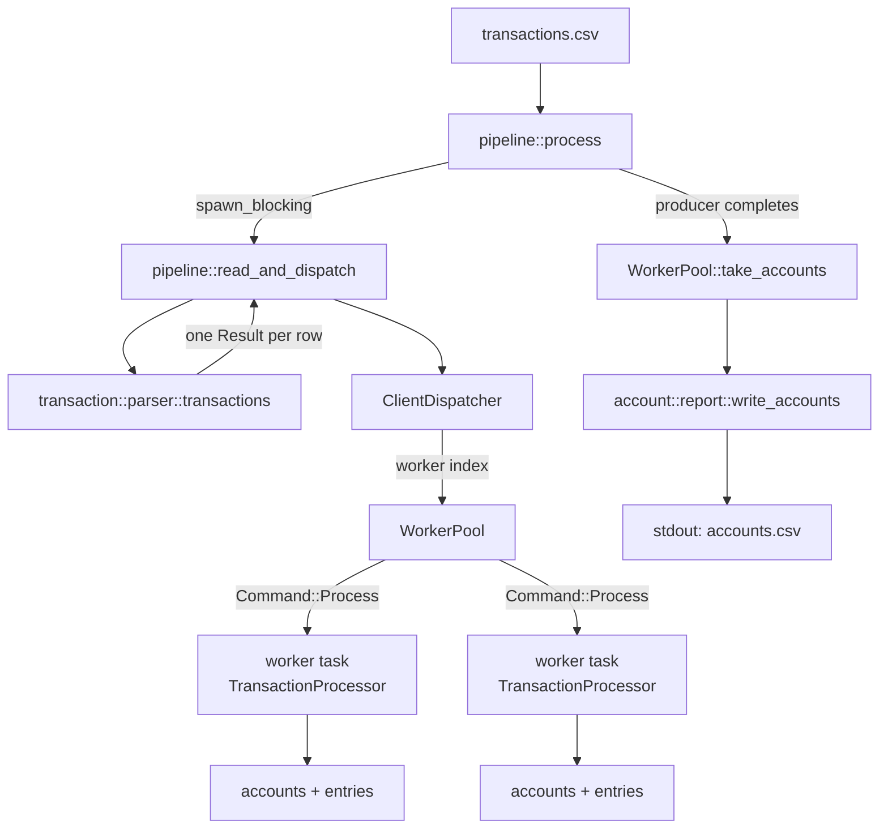
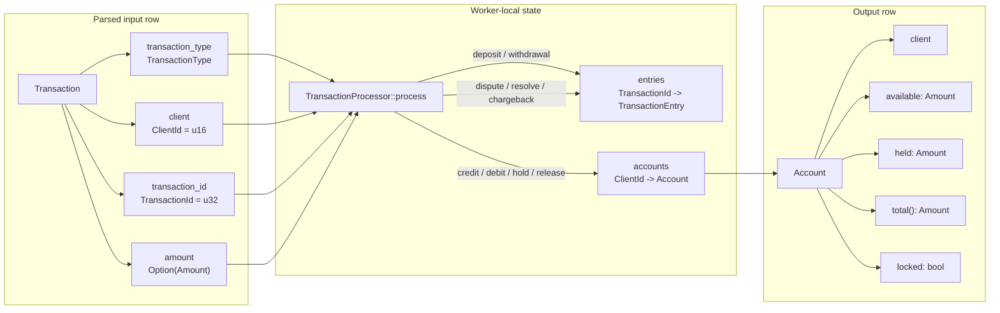

# SmallPaymentEngine


A fast, stream-based transaction processor written in Rust. It reads a
chronological CSV of deposits, withdrawals, disputes, resolves, and
chargebacks, applies each row to per-client account state, and writes the final
accounts CSV to standard output.

The implementation is intentionally lock-free at the account level: each worker
owns a subset of clients, and a client is always handled by the same worker.

## Usage

```sh
cargo run -- transactions.csv > accounts.csv
```

The binary takes exactly one positional argument: the input CSV path. Standard
output contains only the accounts CSV; diagnostics go to standard error.

Set `RUST_LOG` to control diagnostic verbosity in debug and test builds,
including full trace logging:

```sh
RUST_LOG=trace cargo run -- transactions.csv > accounts.csv
```

One diagnostic is emitted without `RUST_LOG`: when a dispute exceeds
`available`, the account is locked and a warning naming the client is written
to stderr. Explicit `RUST_LOG` filtering can suppress that warning in debug and
test builds; release builds clamp `RUST_LOG` to `info`, so the warning is
always emitted there. Logs go to standard error, so stdout remains valid
accounts CSV.

## Architecture

`pipeline::process` is the public entry point. It starts a `WorkerPool`, runs
CSV ingestion on a blocking task, then drains each worker's accounts into one
map for output.



Key properties:

- **Single-pass streaming.** `transaction::parser::transactions` yields one
  `Result<Transaction, ProcessingError>` per CSV row. The reader does not load
  the full input into memory.
- **Client affinity.** `ClientDispatcher` assigns a client to a worker the first
  time it sees that client. New clients go to the worker with the fewest
  assigned clients, then the largest remaining queue capacity, then round-robin
  order. Existing clients stay pinned.
- **Bounded backpressure.** Each worker has a bounded `mpsc` queue
  (`QUEUE_CAPACITY = 256`). The producer uses `blocking_send`; when a queue is
  full, the reader waits instead of growing the backlog.
- **Worker-local state.** Each `TransactionProcessor` owns its
  `HashMap<ClientId, Account>` and `HashMap<TransactionId, TransactionEntry>`.
  No account is mutated by more than one worker, so no locks are needed.
- **Fixed-point currency.** Every amount is an `i64` scaled by `10_000`
  (`1.23` is stored as `12300`). No floating point or decimal crate is used in
  the ledger or amount path.
- **Deterministic output order.** The report currently sorts rows by client,
  though the contract does not require consumers to depend on row order.
  Worker assignment is not visible in stdout.

## Data Flow & Domain Entities



The core types are:

- `Transaction` — a parsed input row: `transaction_type`, `client`,
  `transaction_id`, and optional `amount`.
- `TransactionType` — `Deposit`, `Withdrawal`, `Dispute`, `Resolve`, or
  `Chargeback`.
- `TransactionEntry` — an accepted transaction in the worker's transaction index;
  `Settled` or `Disputed`.
- `Account` — a client's ledger state: `available`, `held`, and `locked`.
  `Account::total()` is always `available + held`.
- `ProcessingError` — the crate's unified error type for row-level validation,
  ledger errors, I/O, and worker failures.

### Operation effects

| Operation | Amount | Account effect | Transaction entry effect |
|---|---|---|---|
| `deposit` | required | `available += amount` | Insert `Settled` |
| `withdrawal` | required | Reject when `available < amount`; otherwise `available -= amount` | Insert `Settled` |
| `dispute` | absent | Reject when `available < amount` and lock the account; otherwise `available -= amount`, `held += amount` | Rejection leaves `Settled`; success moves `Settled` -> `Disputed` |
| `resolve` | absent | `available += amount`, `held -= amount` | `Disputed` -> `Settled` |
| `chargeback` | absent | `held -= amount`, then `locked = true` | Remove the entry; terminal |

See [Notes](#notes) for documented assumptions and edge-case behavior.

## State Pattern Trade-offs

The transaction index uses an enum-based state carried inline in
`TransactionEntry`:

| Pattern | Memory and collections | Compile-time safety | Runtime transitions | Decision |
|---|---|---|---|---|
| Enum-based `TransactionEntry` | Fixed-size variants stored directly in one `HashMap<TransactionId, TransactionEntry>`; no heap allocation per state | Exhaustive `match`; wrong-state transitions are rejected by the processor at runtime | In-place `insert`/`remove`; `dispute` and `resolve` rewrite the same map slot | Selected |
| Typestate (`TransactionEntry<Settled>`, `TransactionEntry<Disputed>`, ...) | Requires distinct types and reallocation per transition; mixed states cannot live in one homogeneous map without erasure | Illegal states are unrepresentable | Transitions consume and rebuild values; awkward for a shared historical index | Skipped |
| Dynamic dispatch (`Box<dyn State>`) | Heap allocation and pointer chasing per entry | Limited to trait-level guarantees | Flexible, but adds indirection and allocation | Skipped |

The enum approach matches the workload: the input is processed chronologically,
historical transactions must remain in a shared lookup map for disputes, and
transitions happen in place. It keeps entries uniform in size and the worker's
state cache-friendly.

## Specifications

### Input schema

The input CSV has a header row and the columns `type, client, tx, amount`.
Rows are trimmed, and the parser tolerates flexible column counts. Column names
are matched exactly (case-sensitive) and may appear in any order; extra columns
are ignored, and a missing or differently-cased column fails the run.

| Column | Type | Rules |
|---|---|---|
| `type` | string | One of `deposit`, `withdrawal`, `dispute`, `resolve`, `chargeback` |
| `client` | `u16` | Client identifier |
| `tx` | `u32` | Transaction identifier |
| `amount` | decimal string | Required for `deposit` and `withdrawal`; empty or absent for the other types. Up to four fraction digits, non-negative, leading dot allowed (`.5` = `0.5`) |

Example:

```csv
type,client,tx,amount
deposit,1,1,1.0
withdrawal,1,2,0.5
```

Rows that cannot be parsed or validated are skipped. With `RUST_LOG=trace`, a
diagnostic is written to stderr. This includes unknown types, missing or
unexpected amounts, invalid UTF-8, invalid client or transaction IDs, malformed
decimals, negatives, more than four fraction digits, and overflow. The one
exception is an over-available dispute: it is skipped, locks the account, and
emits a warning by default. A malformed or renamed header is not a row failure;
it fails the run before row iteration.

### Output schema

The output is `client,available,held,total,locked`, one row per initialized
client. The current writer sorts by client; the contract does not require
consumers to depend on row order.

| Column | Type | Notes |
|---|---|---|
| `client` | `u16` | Client identifier |
| `available` | decimal | Funds available for withdrawal |
| `held` | decimal | Funds frozen by active disputes |
| `total` | decimal | Always `available + held` |
| `locked` | boolean | `true` after a chargeback or a first over-available dispute |

Amounts are rendered with trailing zeros stripped and at least one decimal
place (`1.2300` -> `1.23`, `0.5000` -> `0.5`, `0` -> `0.0`).

Example:

```csv
client,available,held,total,locked
1,0.5,0.0,0.5,false
```

## Tested Scenarios

### Unit tests

- `src/amount.rs` covers fixed-point parsing and formatting: whole and fractional
  amounts, whitespace trimming, varied fraction lengths, leading-dot fractions,
  edge forms such as `1.` and `00.5`, negative rejection, too many decimals,
  malformed input, `i64` overflow, checked arithmetic, canonical `Display`
  output, and error precedence/payloads.
- `src/account/account.rs` covers the zeroed default, the
  `total = available + held` invariant, credit overflow that leaves balances
  unchanged, exact-available holds, and the over-available hold rejection that
  leaves balances unchanged.
- `src/account/report.rs` covers the empty-map header and client-row rendering.
- `src/transaction/parser.rs` covers header matching, reordered and extra
  columns, short non-monetary rows, malformed rows, invalid UTF-8, identifier
  ranges, and amount-presence rules.
- `src/transaction/transaction_processor.rs` covers every state-machine path:
  deposits and withdrawals, insufficient withdrawals, dispute holds,
  over-available disputes that lock the account without changing balances,
  exact-available disputes, unknown transactions, duplicate disputes, resolve,
  invalid resolve, chargeback, invalid chargeback, locked-account rejection,
  cross-client disputes, duplicate IDs, missing amounts, terminal account
  drains, and zeroed initialization of unknown clients.
- `src/transaction/transaction_type.rs` covers parsing, trimming, and rejecting
  type names.
- `src/client/dispatcher.rs` covers assigned-count priority, capacity
  tie-breaking, round-robin tie-breaking, spreading new clients across workers,
  and stable client pinning.
- `src/pipeline.rs` covers the pinned-client capacity fast path.
- `src/worker_pool.rs` covers worker count and initial queue capacity,
  processed-account collection, rejected rows, closed channels, worker panics
  during collection, and blocking backpressure.

### Integration tests

`tests/integration.rs` includes an independent reference oracle written in plain
`i64` arithmetic and covers:

- 100 seeded random transaction sequences compared against the oracle.
- A 10,000-row generated input compared against the oracle.
- Table-driven edge cases: insufficient funds, dispute/resolve, chargeback
  locking, over-available disputes that lock the account, exact-available
  disputes, held funds surviving a rejected dispute, cross-client disputes,
  unknown transactions, duplicate disputes, resolving a non-disputed
  transaction, varying decimal precision, and leading-dot amounts.
- A header-only input producing only the output header.
- Oversized fields: amount overflow, client IDs beyond `u16`, and transaction
  IDs beyond `u32`.
- Strange characters and non-ASCII digits, plus invalid UTF-8 bytes.
- Malformed rows followed by valid rows, proving the stream continues.

### Acceptance tests

The executable specs under `openspec/` are run by the Python `behave` suite in
`acceptance-tests/`. See `acceptance-tests/README.md` for setup.

Run the suites with:

```sh
cargo test
./tests/run_tests.sh
acceptance-tests/.venv/bin/python acceptance-tests/run_acceptance.py
```

`cargo test` runs the unit and integration suites. The acceptance runner builds
the binary, extracts the source-of-truth specs and active change deltas from
`openspec/` into `acceptance-tests/.extracted/` (archived changes are excluded),
composes the effective spec, and writes
`acceptance-tests/reports/behave-report.html`. `.extracted/`, `reports/`, and
`.venv/` are generated and gitignored.

The acceptance suite covers all five capabilities: amount arithmetic, CSV
ingestion, transaction processing, account reporting, and the CLI contract.

### CSV regression fixtures

The `tests/transactions*.csv` fixtures (currently `transactions0.csv` through
`transactions2.csv`) are synthetic cases generated from values that differ from
the specification examples. `tests/run_tests.sh` regenerates the matching
`tests/accounts*.csv` references and fails on drift:

```sh
./tests/run_tests.sh
```

## Correctness

- **Exact money.** Amounts are scaled `i64` values; floating point is absent from
  the parser, ledger, and formatter.
- **Distinct identifier widths.** `ClientId` is a `u16` alias and
  `TransactionId` is a `u32` alias, so the compiler rejects swapping the two
  types without a cast. They are aliases, not newtypes.
- **Recoverable ledger arithmetic.** Balance mutations use checked
  `credit`/`debit`/`hold`/`release`/`chargeback` paths. Overflow becomes a
  `ProcessingError` and the row is skipped. `Amount`'s `Add`/`Sub` operators are
  convenience APIs and panic on overflow, so row processing uses the checked
  methods.
- **Independent verification.** The integration oracle shares no implementation
  with the processor. A disagreement is a real finding, not two copies of the
  same bug.
- **Executable specs.** The acceptance suite runs the Gherkin scenarios in
  `openspec/` against the compiled binary, and the integration oracle verifies
  final state independently of the processor.
- **Regression fixtures.** `./tests/run_tests.sh` regenerates the committed
  account references from the synthetic transaction cases and fails on drift.

## Error Handling

Row-level failures are skipped so the stream can continue. With
`RUST_LOG=trace`, they are logged to stderr. One class is different:
`DisputeExceedsAvailable` is logged at warn level by default, skips the row,
and locks the account. Other examples include `InvalidType`, `InvalidAmount`,
`NegativeAmount`, `TooManyDecimals`, `MissingAmount`, `UnexpectedAmount`,
`InsufficientFunds`, `AccountLocked`, `UnknownTransaction`,
`AlreadyDisputed`, `NotDisputed`, `NotOwner`, `DuplicateTransaction`,
`Overflow`, `Underflow`, and non-I/O `Csv` row errors.

Infrastructure failures fail the run instead of producing silently incomplete
output:

- `WorkerUnavailable` when the producer or a worker channel closes, a worker
  task panics, or the reader task fails.
- `FileOpen` when the input file cannot be opened; the path is included.
- `Io` when writing the accounts CSV fails.
- `InvalidHeader` when the input header is missing or invalid; this is detected
  before row iteration.
- `Csv` when reading the header fails, or when a row error wraps an I/O error;
  ordinary per-row CSV deserialization errors are row-level and are skipped.

`main` prints the error to stderr and exits with a non-zero status.

## Notes

### Assumptions

- **Over-available disputes are rejected and lock the account.** A dispute is
  accepted only when `available >= the referenced transaction's amount`. When
  the amount exceeds `available`, the dispute is skipped without changing
  balances or the transaction entry, and the account is locked immediately. This
  is stricter than the initial design's literal reading, which allowed
  `available` to go negative. The lock is terminal for the run: later rows for
  that client are rejected, held funds remain held, and there is no unlock path.
  The first such rejection emits a warning by default; see [Usage](#usage).
- **Already-disputed transactions are ignored.** A second dispute on a
  transaction already in `Disputed` state is skipped. The specification only
  explicitly requires ignoring unknown transactions; rejecting a transaction
  that is already under dispute follows conservative account behavior.
- **Cross-client references are ignored.** A dispute, resolve, or chargeback
  must reference a transaction owned by the same client. When both clients are
  assigned to the same worker, the mismatch is skipped with `NotOwner`; when
  they are on different workers, the entry is absent from the referencing
  worker's index and is skipped with `UnknownTransaction`.
- **Unknown clients may be initialized by rejected rows.** A parsed transaction
  creates a zeroed account for its client before the operation is validated, so
  a client can appear in the final report even when its first operation is
  skipped.
- **Non-monetary rows must not carry an amount.** A `dispute`, `resolve`, or
  `chargeback` with a non-empty `amount` is skipped with `UnexpectedAmount`; the
  specification says these rows omit the amount.
- **Resolved transactions can be disputed again.** `resolve` returns the entry
  to `Settled`, so a later `dispute` can hold the same funds again. The
  specification does not explicitly forbid a second dispute after resolution.
- **Locked accounts reject all later operations.** A successful chargeback or a
  first over-available dispute sets `locked = true`; every later row for that
  client is skipped with `AccountLocked`. This follows the frozen-account
  behavior in the specification.
- **Disputes may target withdrawals.** Accepted withdrawals are indexed as
  settled transactions, so a dispute can reference one and the hold rules,
  including the over-available lock, apply unchanged. The alternative
  (deposits-only disputes) is the more conservative reading; the specification
  does not restrict the referenced transaction type.
- **Output precision follows the example.** Amounts are rendered with trailing
  zeros stripped and at least one decimal place, matching the SPEC §3.2 example.
  This supersedes §2.3's "four-decimal" prose under the §7.2 precedence rule.
- **The transaction index grows with accepted transactions.** Input is streamed
  and in-flight work is bounded, but disputes must resolve earlier identifiers,
  so ledger memory scales with accepted monetary rows rather than being O(1) in
  the log size.

### Edge behavior

- A successful chargeback removes the transaction entry; the entry is terminal.
- An over-available dispute is skipped with `DisputeExceedsAvailable` and locks
  the account; later rows for that client are rejected with `AccountLocked`.
- An unknown transaction is skipped with `UnknownTransaction`; a wrong-state
  reference is skipped with `NotDisputed` or `AlreadyDisputed`; the stream
  continues.

## Project Layout

```text
src/                          Shared library and binary entry points
  account/                    Account state and reporting
    account.rs                Client account and ledger operations
    report.rs                 Accounts CSV writer
  client/                     Client identity and routing
    client_id.rs              ClientId alias
    dispatcher.rs             Least-loaded client-to-worker assignment
  transaction/                Transaction model, parsing, and processing
    parser.rs                 CSV parsing and validation
    transaction.rs            Transaction input row
    transaction_entry.rs      Settled/Disputed lifecycle entry
    transaction_id.rs         TransactionId alias
    transaction_processor.rs  Per-worker account and entry state machine
    transaction_type.rs       Deposit/withdrawal/dispute/resolve/chargeback enum
  amount.rs                   Fixed-point i64 currency and formatting
  lib.rs                      Crate module declarations and visibility
  main.rs                     CLI entry point
  pipeline.rs                 Streaming ingestion, dispatch, and output
  processing_error.rs         Recoverable and infrastructure errors
  worker_pool.rs              Bounded queues and worker lifecycle
tests/
  integration.rs              Independent oracle and edge-case tests
  run_tests.sh                Optional CSV regression runner
  transactions*.csv           Synthetic transaction inputs
  accounts*.csv               Reference account outputs
acceptance-tests/             behave suite executing the OpenSpec specs
  run_acceptance.py           Single entry point
  extract_gherkin.py          Markdown spec -> .feature extractor
  openspec_effective_spec.py  Applies active-change supersession
  behave.ini                  behave runner and report configuration
  .gherkin-lintrc             Gherkin lint rules
  environment.py              Builds the binary and resets per-scenario state
  steps/                      Domain step definitions
  pages/                      CLI page object
  requirements.txt            Python harness dependencies
```

## AI Assistance

This implementation was developed with AI assistance using:

- **opencode** — Agentic coding environment
- **DeepSeek** — Language model used for implementation and review
- **Minimax** — Language model used for implementation and review
- **intent-driven-development** — Change planning and execution workflow - https://github.com/intent-driven-dev/intent-driven-template
- **rust-skills** — Rust coding guidelines and review rules — https://github.com/leonardomso/rust-skills
