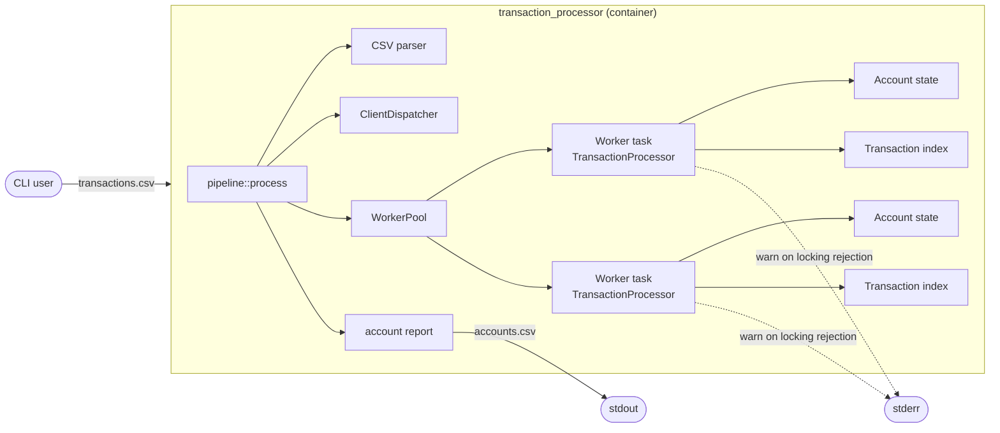

# Design: reject-dispute-overdraft

## Context

The current in-memory processor is a single CLI container. `pipeline::process` reads the CSV on a blocking task, dispatches rows through a fixed worker pool, and each worker owns a `TransactionProcessor` with its clients' accounts and transaction index. `Account` holds `available`, `held`, and `locked`; `TransactionProcessor::process_dispute` calls `Account::hold` and then marks the entry `Disputed`.

`Account::hold` currently subtracts the amount from `available` without checking that the funds are there. That permits a dispute to drive `available` negative, which enables the fraud path described in the proposal: deposit, withdraw, dispute the deposit, charge back the dispute, and leave the bank with a negative balance and no remaining hold.

This change deliberately departs from the initial interpretation. The relevant requirements are the new `A dispute requires sufficient available funds` requirement and the amended `Rejected operations do not mutate ledger state` requirement in `specs/transaction-processing/spec.md`. The CLI warning carve-out is in `specs/processor-cli/spec.md`; the lock reporting and defensive rendering changes are in `specs/account-reporting/spec.md` and `specs/amount-arithmetic/spec.md`.

### In-force ADRs reviewed

- `adr/0001-fixed-worker-pool-sharding.md` — client affinity, worker-local state, and bounded queues are unchanged. The dispute path stays inside one worker.
- `adr/0002-fixed-point-i64-money.md` — amounts remain `i64` scaled by 10,000; no floating point or decimal dependency is introduced.
- `adr/0003-single-pass-streaming-lifecycle.md` — single-pass ingestion, bounded backpressure, and snapshot-then-shutdown are unchanged. The new warning goes to stderr and does not touch stdout.

No ADR has a `Supersedes` field, so all three remain in force. None needs revision. The ADR step will add a new durable record for the dispute policy and will reference these three as reviewed and unaffected.

### Architecture views

These are lightweight C4-inspired views, not strict C4. Format is plain Mermaid, matching the repository's README convention. The question they answer is where the funds check, lock transition, and warning live in the existing CLI container.



```mermaid
sequenceDiagram
    participant W as Worker task
    participant P as TransactionProcessor
    participant I as Transaction index
    participant A as Account
    participant L as stderr logger

    W->>P: process(dispute)
    P->>P: initialize client; check locked
    alt account locked
        P-->>W: AccountLocked (trace only)
    else account active
        P->>I: lookup(tx)
        alt unknown, foreign, or already disputed
            I-->>P: error (trace only, no lock)
            P-->>W: error
        else settled
            P->>A: hold(amount)
            alt available >= amount
                A-->>P: available -= amount, held += amount
                P->>I: mark Disputed
                P-->>W: ok
            else available < amount
                A-->>P: DisputeExceedsAvailable
                P->>A: locked = true
                P-->>W: DisputeExceedsAvailable
                W->>L: warn(client, tx, amount, available, "account locked")
            end
        end
    end
```

- **Boundary:** one CLI container; workers own disjoint account and transaction-index state; no new service, database, queue, or dependency.
- **Responsibilities:** `Account` enforces the balance invariant; `TransactionProcessor` owns the dispute and lock policy; the worker loop owns diagnostics.
- **Key relationship:** only the insufficient-`available` branch locks. Unknown, foreign, already-disputed, and locked-account paths leave state unchanged.
- **Assumptions:** state is run-scoped and in memory; the stdout contract is unchanged; the warning is the only new stderr observable.
- **Open questions:** none blocking. The ADR step records the first-attempt lock and default warning as deliberate deviations.

## Goals / Non-Goals

**Goals:**

- Reject a dispute whose amount exceeds `available`, leaving `available`, `held`, and the transaction entry unchanged.
- Lock the account on the first such rejection through the existing terminal `locked` state.
- Emit exactly one warn-level stderr warning per account locked this way, with the client and lock visible.
- Preserve per-client ordering, worker isolation, fixed-point arithmetic, single-pass streaming, and the stdout schema.
- Keep the integration oracle and acceptance suite aligned with the same rule.

**Non-Goals:**

- Partial disputes or holding only the available portion.
- A terminal `charged_back` journal row, counter, threshold, or retry path.
- Persistence, the Kafka/database-backed variant, or cross-client transfers.
- Releasing, refunding, or settling held funds on a locked account.
- A new output column, a configurable threshold, or structured metrics beyond the stderr warning.
- Rewriting `SPEC.md`; it remains the historical baseline.

## Decisions

### D1: Enforce the invariant in `Account::hold`, apply the lock in `TransactionProcessor::process_dispute`

`Account::hold` gains a pre-check: when `self.available < amount`, it returns a distinct error before mutating either balance. `TransactionProcessor::process_dispute` captures the `hold` result; on that specific error it sets `account.locked = true` and returns the error, and on success it inserts the `Disputed` entry as today. Only the insufficient-`available` branch locks; `Underflow` and `Overflow` from the checked arithmetic do not.

Alternatives considered:

- Check only in `process_dispute`: leaves `Account::hold` able to produce a negative balance for any future caller, so the invariant would have two enforcement points or none.
- Lock inside `Account::hold`: mixes balance arithmetic with fraud policy and makes the account harder to test in isolation.
- Reuse `InsufficientFunds`: withdrawals already use it, and the worker could not distinguish a withdrawal rejection from a locking dispute warning.

The account borrow is released before the transaction index is mutated, so the existing state-machine structure stays intact.

### D2: Add a distinct recoverable `DisputeExceedsAvailable` error

Add a structured variant to `ProcessingError` carrying the disputed amount and the available balance. Its `Display` text is used in diagnostics. `is_recoverable` keeps its wildcard, so the variant is recoverable; the worker chooses the warning explicitly rather than relying on the wildcard.

Alternatives considered:

- A tuple or string variant: loses structured amount/available fields.
- A separate `HoldError` type: cleaner layering but expands the error surface for a single new case.
- Reusing `InsufficientFunds`: conflates withdrawal and dispute failures.

Adding a variant to a public enum is a source-level change for exhaustive matches. The crate is not published, and no in-crate match enumerates every variant; the worker's warning arm is an explicit addition. Making the enum `#[non_exhaustive]` is deferred as an unrelated API-hardening question.

### D3: Warn from the worker error boundary

`run_worker` currently logs every recoverable row error at trace level and infrastructure errors at error level. Add an explicit arm before the generic recoverable arm for `DisputeExceedsAvailable`, using `tracing::warn!` with the client, transaction ID, disputed amount, available balance, and an "account locked" message. Every other recoverable error stays trace-only.

The warning is emitted once per account because the first over-available dispute locks the account; later rows for that client return `AccountLocked` and remain trace-only. The worker is the existing logging boundary and has the transaction context, so the domain processor stays free of tracing.

Alternatives considered:

- Log inside `process_dispute`: couples the ledger state machine to diagnostics and makes unit tests noisy.
- Log in `pipeline`: the pipeline sees dispatch errors, not per-row domain rejections.
- Use `error!`: overstates a recoverable row rejection and blurs the infrastructure-error channel.

`warn!` is compiled into release builds. `main::init_tracing` defaults to the `warn` filter and clamps a supplied `RUST_LOG` to `info` in release, so the warning is visible there. In debug and test builds the default filter is also `warn`; explicit `RUST_LOG=error` suppresses it, as the CLI spec states.

### D4: Reuse the terminal `locked` flag; keep the entry settled; no counter

The first over-available dispute sets the existing `Account::locked` flag. `TransactionProcessor::process` checks that flag at the top of every row, so every later row for the client is rejected as locked before validation. The transaction entry stays `Settled`; it is not marked `Disputed` and is not removed. Funds held by existing active disputes remain held, so the report can show `locked = true` with `held > 0`.

A later chargeback for that client is rejected by the locked-account guard before the entry state is examined; the entry's settled state is the reason it would also fail the not-disputed check, but the observable rejection is the lock. The acceptance scenario asserts the final balances, held, total, and lock state rather than an internal error variant.

Alternatives considered:

- A separate fraud-lock or restricted flag: adds a second lock semantic and complicates the report, which has only a `locked` column.
- Allowing resolve or chargeback on a locked account: avoids stranded holds but contradicts the existing terminal-lock rule and was not chosen.
- Releasing or charging back held funds on lock: changes balances unexpectedly and creates an exploit path.
- A counter or three-strike threshold: explicitly rejected in favor of a first-attempt lock.

The accepted cost is that a legitimate mistake can lock a client and strand held funds; this is recorded in the ADR as a support limitation, not solved here.

### D5: No new account state, dependencies, or output surface

The existing `locked` bool is sufficient, so `Account` gains no field. No crate is added: the warning uses the existing `tracing` stack. No CLI flag or configuration is added; the threshold is the first attempt. The accounts CSV schema is unchanged and the counter does not exist, so nothing new is emitted to stdout. The only public API change is the `ProcessingError` variant.

The resulting ledger invariant is `available >= 0` and `total >= 0`. Withdrawal already rejects insufficient funds, credit and release only add, and chargeback reduces held without touching available; the new `hold` check closes the only remaining path.

### D6: Align the spec deltas with the tooling's no-scenario-drop rule

OpenSpec refuses to drop a scenario from a `MODIFIED` requirement. The dispute-hold requirement and the two rendering requirements are therefore replaced via `REMOVED` + `ADDED` with clearer names, while the atomicity, CLI, and locked-column requirements are `MODIFIED` with every existing scenario retained. The acceptance composer matches requirement names exactly, so tasks and acceptance steps must use the new names. Negative rendering remains defensive formatter behavior covered by the existing `Amount` unit test; it is no longer an end-to-end ledger expectation.

## Risks / Trade-offs

| Risk | Mitigation |
|---|---|
| A legitimate client is locked by one mistaken or unusual over-available dispute, including a dispute of a withdrawal. | Accepted policy; the warning and ADR document it; tests pin the behavior; no unlock path is in scope. |
| Held funds from active disputes are frozen under the terminal lock. | Accepted and documented; existing chargeback locks already have this property; releasing or refunding is out of scope. |
| The lock cause is not observable in the accounts CSV. | The stderr warning is the signal; no output column is added; the ADR records the support limitation. |
| The new error variant falls into the generic trace-only branch, so no default warning appears. | Add an explicit match arm in `run_worker` and a unit/integration test for the warning. |
| The lock is applied to `Overflow`/`Underflow` instead of only insufficient availability. | Match only `DisputeExceedsAvailable`; add tests for exact-available success and for overflow paths that do not lock. |
| `accounts1.csv` changes all five rows, and the acceptance suite loses a mixed lock-state baseline. | Regenerate and review the reference; add dedicated locked and unlocked cases; verify `accounts0` and `accounts2` stay unchanged. |
| The integration oracle diverges from the ledger on random inputs. | Update the oracle's dispute branch with the same funds check and lock in the same task; keep dedicated fraud-path cases. |
| Requirement names changed during the spec replacement. | Use the new names in tasks and acceptance steps; run `openspec validate`; the composer warns when a modified requirement name is not found. |
| Release and debug builds differ in warning suppressibility. | `warn!` is compiled in release and the release filter includes warn; the CLI spec states debug/test suppression; acceptance covers the default and `RUST_LOG=error` in a test build. |
| The warning text becomes brittle in acceptance tests. | Assert a stable minimum: client ID and an "account locked" statement; keep the full wording out of the contract. |

## Migration Plan

- This is an in-memory CLI; there is no data or schema migration.
- Implement the ledger and worker changes together, update the integration oracle, then regenerate `tests/accounts1.csv` after reviewing every changed row. `tests/accounts0.csv` and `tests/accounts2.csv` are expected to remain unchanged.
- Update `README.md` assumptions, the operation-effects table, the output-schema `locked` note, the diagnostics paragraphs, the error list, and the tested-scenarios text.
- Add the new acceptance steps for the warning content and the `RUST_LOG=error` suppression, then run the unit, integration, fixture, and acceptance suites.
- Add the durable ADR recording the first-attempt lock and default warning as deliberate deviations from the initial design; `SPEC.md` stays untouched.
- Rollback is a source revert with no persisted state to clean up. The behavior change is immediate; there is no feature flag. Release notes should call it out as breaking.

## Open Questions

- None blocking.
- Should `ProcessingError` be marked `#[non_exhaustive]` to reduce future source breakage? Deferred as unrelated API hardening; the crate is not published.
- Should the lock cause be exposed in the report? No: the output schema is fixed and the warning is the operational signal. A future reporting change would be separate.
- In-force ADR impact: ADR-0001, ADR-0002, and ADR-0003 remain in force and unaffected. The ADR step creates a new durable record for the dispute policy; no existing ADR needs supersession.
