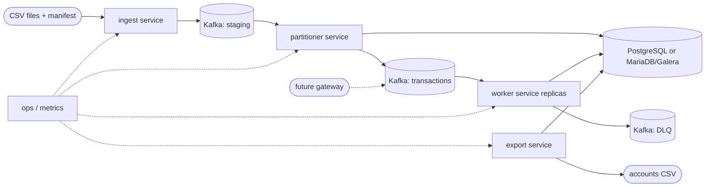
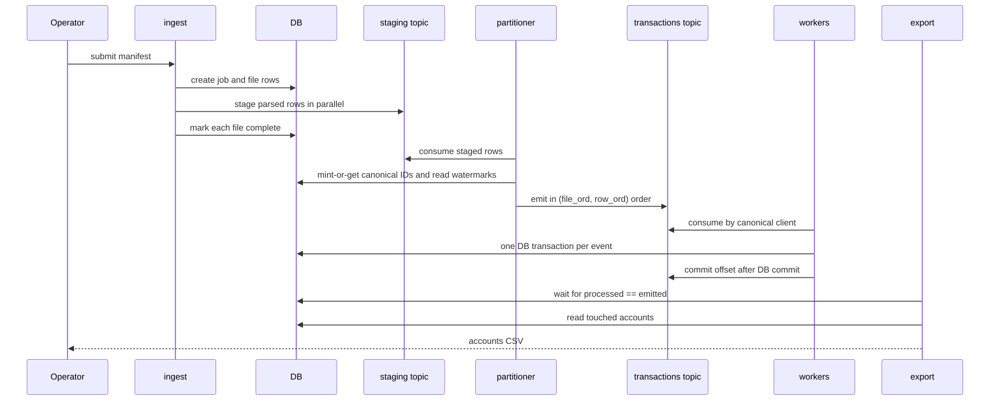

# Design: kafka-distributed-ledger

## Context

The current in-memory CLI is the single-node reference: one process, one CSV input, worker-local account and transaction maps, stdout accounts CSV, and no durable state. It remains unchanged and keeps its u16 client schema and bare `cargo run` behaviour.

The distributed variant adds a separate crate/workspace member. It reuses the `Account` arithmetic and the ledger rules, but the current `TransactionProcessor` is stateful and owns its maps, and `ClientId` is `u16`; the shared core must be extracted and the identifier/index boundary generalized before a durable adapter can use it.

The variant has six new capabilities: `client-identity`, `stream-ingestion`, `distributed-ledger`, `job-reporting`, `database-portability`, and `distributed-operations`. The detailed requirements are in `openspec/changes/kafka-distributed-ledger/specs/`.

### In-force ADRs reviewed

- `adr/0001-fixed-worker-pool-sharding.md` — in-memory client affinity and worker-local state. The distributed variant preserves the ownership principle through Kafka partition ownership; it does not change the CLI.
- `adr/0002-fixed-point-i64-money.md` — `i64` scaled by 10,000 and no floating point. The distributed schema stores the same scaled integers.
- `adr/0003-single-pass-streaming-lifecycle.md` — bounded streaming and snapshot/shutdown for the CLI. The distributed variant adds durable checkpoints and offsets rather than changing the CLI lifecycle.
- `adr/0004-reject-dispute-overdraft.md` — first-attempt dispute lock and the default warning. The distributed variant inherits the lock and warning contract and must persist the lock and emit the canonical-client warning.

No ADR has a `Supersedes` field. All four remain in force. The ADR step will add new durable records for the distributed decisions and will not modify these files.

### Architecture views

These are lightweight C4-inspired views, plain Mermaid, not strict C4. They answer how the new variant is deployed and how a job flows through it.





```mermaid
sequenceDiagram
    participant K as Kafka
    participant W as worker
    participant D as DB
    participant L as logs / DLQ

    K->>W: record(event)
    W->>D: BEGIN; insert ledger_event(event_id)
    alt already applied
        D-->>W: no-op
        W->>K: commit offset
    else new ledger effect
        W->>D: insert job_event(job_id, event_id)
        W->>D: SELECT account FOR UPDATE
        W->>D: lookup transaction index
        W->>D: apply ledger rules, journal, progress, job_clients
        W->>D: COMMIT
        W->>K: commit offset
        W-->>L: warn on over-available lock; DLQ on exhausted retry
    end
```

- **Boundary:** one new distributed crate plus separate ingest, partition, worker, export, and migrate entry points; the existing CLI remains a different container.
- **Responsibilities:** ingest validates manifests and stages parsed rows; the partitioner owns per-client ordering and identity mapping; workers own atomic ledger effects; export owns job completion and CSV output; the DB owns durable state.
- **Key relationship:** Kafka keys are canonical client IDs only on the transactions topic; staging keys are source-scoped external keys. The database is the source of truth for identity, ordering watermarks, idempotency, and progress.
- **Assumptions:** v1 uses one logical database, one active batch job, and a fixed topic partition count chosen before ingestion. The gateway is future.
- **Open questions:** partition count, allocator block size, buffer bounds, retention policy, and the Galera CI topology are deferred to design/tasks or operations.

## Goals / Non-Goals

**Goals:**

- Add a durable, partitioned variant that preserves per-client input order across overlapping files.
- Assign globally unique, stable canonical `BIGINT` client IDs from source-scoped external keys.
- Apply the existing ledger and dispute rules atomically with at-least-once delivery and DB idempotency.
- Keep a full, terminal transaction journal with global `tx_id` uniqueness.
- Produce a deterministic, job-scoped accounts CSV for touched clients.
- Support PostgreSQL and MariaDB/Galera behind one repository contract.
- Keep the existing CLI, its output, and its packaging contract unchanged.
- Make operational state (lag, DLQ, stalled watermarks, failed jobs) visible.

**Non-Goals:**

- Cross-client money transfers, partial disputes, or unlocking stranded held funds.
- A payment gateway or live streaming mode.
- DB sharding, cross-shard transactions, or write scaling beyond one logical database.
- gRPC, HTTP, or WebSocket variants.
- Changing the in-memory journal or the CLI's u16 schema.
- Exactly-once Kafka transactions spanning Kafka and the database.

## Decisions

### D1: Separate distributed crate; keep the existing package and CLI intact

The distributed variant lives in its own crate/workspace member with its own binaries and migrations. The existing package remains the default member with its single binary; no `[[bin]]` or `default-run` is added to it, so bare `cargo run` still selects the in-memory CLI. The public submission remains the existing crate; the distributed crate is delivered separately or excluded from the sanitized submission.

Alternatives considered:

- Add binaries to the existing package: breaks the graded bare `cargo run` contract.
- Use `default-run`: changes the package manifest and still leaves multiple binaries in the public crate.
- A separate repository: operationally heavier; a workspace member keeps review and tests together.

### D2: Extract a pure shared ledger core with an explicit library API break

Extract the ledger state machine into a storage-independent core: `Account` arithmetic remains reusable; the core accepts an account, a transaction, and a journal lookup, and returns the resulting account/journey effect (or a domain error) without owning maps. The in-memory adapter provides a HashMap journal and preserves its current chargeback-delete behavior. The distributed adapter provides a durable journal and retains terminal `charged_back` rows. A generic or new canonical client identifier separates the CLI's `u16` from the distributed `BIGINT`.

This is a **BREAKING** change for library consumers (`ClientId`, processor internals, and the shared API), but not for the CLI's observable behavior. A CLI regression test must cover chargeback-then-reuse of a `tx` ID so the in-memory delete behavior does not silently change.

Alternatives considered:

- Duplicate the rules in the distributed crate: invites drift and violates the shared-core constraint.
- Keep the stateful processor and wrap it: the maps cannot be replaced by a database without owning the state machine.
- Make the separate crate copy the types: same drift problem.

### D3: Source-scoped external keys and DB-minted canonical IDs

The external key is `(source_id, external_client: u16)`, preserving the existing CSV parser while preventing two sources from collapsing the same `client 1`. The partitioner calls a repository `mint_or_get` operation; the DB enforces a unique `(source_id, external_client)` constraint and a unique canonical `client_id`. The mapping is performed before the transactions produce, so workers never mint or remap identities. The job report uses the canonical `BIGINT` as its `client` column.

Alternatives considered:

- Bare `u16` as the global key: 65,536 clients and cross-source collisions.
- A widened text CSV key: changes the existing CSV schema and parser contract.
- Mint in the worker: cannot key the transactions topic by canonical ID before consumption.

### D4: Manifest order plus DB-backed watermarks; content-addressed event identity

Each manifest entry carries `source_id`, a unique non-negative `file_ord`, a file hash, and a location. Ingest parses files in parallel and stages the parsed transaction plus `(job_id, source_id, external_client, file_ord, row_ord)`. A file is marked complete only after all its rows are staged. The partitioner reads the DB watermarks and emits a client's rows in ascending `(file_ord, row_ord)` order; a later file waits for every earlier file in the same job/source.

All events for a source-scoped external key are keyed to one staging partition, so one partitioner owner buffers and emits that client's events. Buffers are bounded and apply consumer backpressure. Event identity is content-addressed from `(source_id, file_hash, row_ord)`, so re-staging the same file under a later job is a ledger no-op while still recording that job's progress and touched clients.

Alternatives considered:

- Event-time ordering: the CSV has no timestamp; file/row ordinals are the only reliable order.
- Arrival order: overlapping files would reorder a client's rows.
- Job-scoped event IDs: re-ingestion under a new job would re-apply dispute/resolve sequences.
- One partitioner instance only: correct but not partition-scalable.

### D5: One DB transaction per event, offset after commit

Each worker record runs in one DB transaction: insert the content-addressed `ledger_event` (dedupe), insert the job event (job idempotency/progress), lock the account row, look up the transaction index, apply the shared ledger core, update the journal, progress, and touched clients, then commit. The Kafka offset is committed only after the DB commit. A crash between commit and offset causes redelivery; the ledger event dedupe makes it a no-op while the job event dedupe prevents double progress.

At-least-once delivery plus DB idempotency is the contract; Kafka transactions spanning Kafka and the DB are not used. Duplicate monetary IDs are `DuplicateTransaction`; a dispute/resolve/chargeback referencing another client's transaction is `NotOwner`.

Alternatives considered:

- Commit the offset first: loses an event on a DB failure.
- Kafka EOS plus DB: cannot make the DB and Kafka commits atomic without a distributed transaction.
- A single global process: does not survive rebalance or scale.

### D6: Global transaction index, terminal journal, and schema

The schema has `clients`, `accounts`, `transactions`, `ledger_events`, `jobs`, `job_files`, `job_events`, `job_progress`, `job_clients`, and `id_allocator`. `transactions.tx_id` is a global primary key; `transactions.client_id` is indexed. The journal state is `settled`, `disputed`, or `charged_back`; a chargeback updates the row to `charged_back` and never deletes it. The account row stores `available`, `held`, and `locked` as scaled `BIGINT`s; the code enforces non-negative available/held and `total = available + held`, with DB checks where both backends support them.

A parsed row inserts a zeroed account and a `job_clients` row before domain validation, so a rejected row's client is exported. The global index is a single unpartitioned table in one logical database; this is the explicit write/scale ceiling.

Alternatives considered:

- Delete on chargeback: loses audit history and allows ID reuse.
- Partition the transaction index by client: cannot enforce global `tx_id` uniqueness without a global constraint.
- Store balances only in an event log: adds projection/checkpoint complexity before the CSV report is defined.

### D7: PostgreSQL and MariaDB/Galera behind one repository contract

A repository trait covers mint-or-get, account locking, ledger event insertion, transaction lookup/upsert, job progress, and reporting queries. Two adapters own dialect differences: Postgres `ON CONFLICT` versus MariaDB `ON DUPLICATE KEY UPDATE`, boolean representation, timestamp types, and backend-specific migration paths. Runtime SQL (not compile-time macros) keeps one build usable with either feature set.

The portable `id_allocator` table allocates IDs in blocks. A conflict during mint-or-get may leave unused IDs (gaps are acceptable); the mapping row and its ID are committed atomically. IDs are never reused.

Both backends use `READ COMMITTED` plus `SELECT ... FOR UPDATE`. Postgres deadlocks/serialization failures and MariaDB/Galera certification conflicts are retried with bounded exponential backoff and jitter. Exhaustion sends the event to the DLQ and fails the job; no partial account write is committed.

Galera is treated as virtually synchronous, certification-based, multi-primary HA. It replicates the full dataset and is not a sharding mechanism; v1 uses one logical database. Cross-shard transactions are out of scope.

Alternatives considered:

- Native auto-increment: behaves differently under Galera and is not portable.
- Postgres-only: fails the configurable-backend requirement.
- Two independent schemas with divergent semantics: violates one contract and doubles the test matrix.

### D8: Job-scoped export with one active batch job

The exporter waits for `job_progress.processed == emitted` on every transaction partition that has emitted events, and for the partitioner to finish the job. It then reads `job_clients` and their accounts and writes `client,available,held,total,locked` with canonical `BIGINT` IDs. Clients initialized by rejected rows are included with zero balances. No partial CSV is written while a partition lags.

A `job_lock` singleton row serializes submissions in v1: one active job at a time; a second submission is rejected as `JobAlreadyActive`. An unrecoverable manifest/file error marks the job `failed`, writes no CSV, and releases the lock so a later job can start. Re-submitting a completed manifest hash returns the existing job/export or a no-op replay; it does not double-apply events.

Alternatives considered:

- Concurrent jobs: the current-state export would not be a deterministic job snapshot without a per-client job-scoped ledger.
- Materialized per-job account snapshots: more tables and write amplification; deferred.
- On-demand current-state export: loses the batch completion contract.

### D9: Operations are explicit and observable

Configuration is loaded from a documented file plus environment overrides; required broker, database, topic, and credential settings fail fast; secrets are redacted from logs. A `migrate` command applies backend migrations and verifies/creates topics idempotently. Transient failures use bounded retries; exhausted events go to a DLQ with job/file/row/error metadata; a poison event fails the job rather than being skipped. Services expose health/readiness and metrics for consumer lag, DLQ depth, stalled watermarks, and failed jobs.

Alternatives considered:

- Silent retries: hide poison events and stall jobs.
- Log-only metrics: cannot alert on lag or stalled watermarks.
- Auto-creating topics on every service start: races and hides provisioning errors.

### D10: Kafka topology and ownership

- `staging` topic: keyed by `source_id + external_client`, partitioned for parallel ingestion; it carries parsed transaction payloads and job/file/row coordinates.
- `transactions` topic: keyed by canonical `client_id`; partition count is chosen high before ingestion because increasing it rekeys clients.
- `DLQ` topic: carries exhausted events with metadata.
- `migrate` exposes `--staging-partitions`, `--transactions-partitions`, and `--dlq-partitions`. The `transactions` count is fixed before ingestion because changing it rekeys canonical clients.
- DB watermarks, not a single control topic, are the ordering source; file completion is durable and queryable.
- Workers use a consumer group; partition ownership gives one worker per transaction partition. The partitioner uses staging partition ownership so each source-scoped client is owned by exactly one partitioner replica at a time. Many clients share a staging partition, and one replica may own several partitions; the partition count is a fixed parallelism knob, not a per-client count.

Alternatives considered:

- One topic for staging and transactions: cannot change keys without a repartition stage.
- A single control topic consumed by every partitioner: requires per-instance consumer groups or broadcast and is harder to make durable.
- Few partitions: caps consumer parallelism; the chosen count is an operational input.

### D11: Kafka client

`rdkafka` 0.37, dynamically linked against system librdkafka, is the producer, consumer, and admin client. `rskafka` was the initial pure-Rust choice, but it explicitly has no consumer-group membership, rebalancing, offset tracking, or transactions. Those are core requirements for the partitioner and worker (ADR-0009, ADR-0013), so the native dependency is accepted.

The crate is pinned to `rdkafka` 0.37 with `rdkafka-sys` 4.8.0+2.3.0 because Debian trixie provides librdkafka 2.8. `rdkafka` 0.39 requires librdkafka 2.12 or newer. Producers use idempotent delivery; consumers disable auto-commit and commit offsets only after the durable work. The `migrate` command uses the admin client for idempotent topic creation and for the destructive topic recreation in `--fresh`.

Alternatives considered:

- `rskafka` with manual partition assignment and DB-stored offsets: no rebalancing, manual scaling, and a design change to ADR-0009.
- Implementing the consumer-group protocol directly: high risk and outside the ledger problem.
- Hybrid `rskafka` admin plus `rdkafka` consumer: two clients and two failure modes.
- Another pure-Rust client: available crates provide manual assignments and group-offset storage, not dynamic membership.

## Risks / Trade-offs

| Risk | Mitigation |
|---|---|
| Shared-core extraction changes CLI behavior, especially chargeback-delete semantics. | Keep the in-memory adapter's delete policy, add a CLI regression test for chargeback-then-reuse, and run the cross-variant conformance suite. |
| Single global transaction index and one logical DB cap write throughput. | State the ceiling; scale consumer parallelism only; treat sharding as a separate change. |
| Galera certification conflicts abort transactions. | Bounded retries with jitter; map to DLQ on exhaustion; test on a multi-node cluster where available. |
| Replicas are mistaken for write scaling. | Document that replicas add availability/consumer parallelism; write capacity is DB-bound. |
| Partitioner buffers grow or a file stalls the watermark. | Bound buffers, pause consumers, expose stalled-watermark metrics, and fail the job on terminal file errors. |
| Serialized jobs limit batch concurrency. | Accept for deterministic v1 export; design per-job isolation later. |
| Full journal and idempotency tables grow without bound. | Record retention as an operational follow-up; no v1 cleanup policy. |
| Event re-ingestion double-applies a dispute/resolve sequence. | Content-addressed ledger events; separate job events for progress; tests for duplicate manifests. |
| Kafka partition increase rekeys clients. | Choose partition count up front; plan a controlled rekey/migration. |
| At-least-once is mistaken for exactly-once across Kafka and DB. | Commit the offset after the DB commit and rely on idempotent ledger/job event inserts. |
| Poison event silently skipped. | DLQ plus failed job; no partial export. |
| Acceptance harness and containers are heavy. | Use contract tests and a cross-variant oracle; keep Galera cluster tests optional/skipped when unavailable. |
| Credentials leak through logs. | Redact secrets; test configuration logging. |

## Migration Plan

- Add the separate distributed crate/workspace member; the existing package, CLI, and public submission remain unchanged.
- Extract the shared ledger core and keep the in-memory CLI green before adding the distributed adapters.
- Create the backend migrations and repository contract; run contract tests on PostgreSQL and MariaDB (Galera cluster where available).
- Provision `staging`, `transactions`, and `DLQ` topics with the chosen partition count; run the `migrate` command.
- Deploy workers, partitioner, ingest, and export; submit a small manifest and compare its export with the same CSV run through the CLI.
- Roll back by stopping the new services; the CLI is unaffected. There is no CLI data migration; the distributed ledger starts from its own schema, and files can be re-ingested idempotently.
- Release notes should call out the new infrastructure, the single-logical-DB write ceiling, the serialized-job limitation, and the unbounded journal/idempotency retention.

## Open Questions

- What partition count should the v1 `transactions` topic use, given rekeying cost?
- What block size should the portable ID allocator use, and are gaps acceptable? (Design assumes gaps are acceptable.)
- What per-client and global buffer bounds should the partitioner use, and what is the backpressure policy?
- What retention/archival policy applies to the full journal and idempotency records after v1? Tracked as the future `journal-retention-policy` change.
- What is the Galera CI topology (single-node contract tests plus optional 3-node conflict tests)?
- When the gateway lands, how will live events and backfilled batches share the ordering/watermark contract?
- Should a later change add per-job account snapshots to allow concurrent jobs without serializing?
- The ADR step will create new durable ADRs for packaging, identity, ordering, worker/DB atomicity, journal, portability, and job serialization; ADR-0001 through ADR-0004 remain in force and are not superseded.
